# Diagrams

<!-- Generated by tools/build.py from schemas/. Do not edit. -->

## Domain dependencies

An arrow from A to B means entities in A reference entities in B; the label is the number of references.

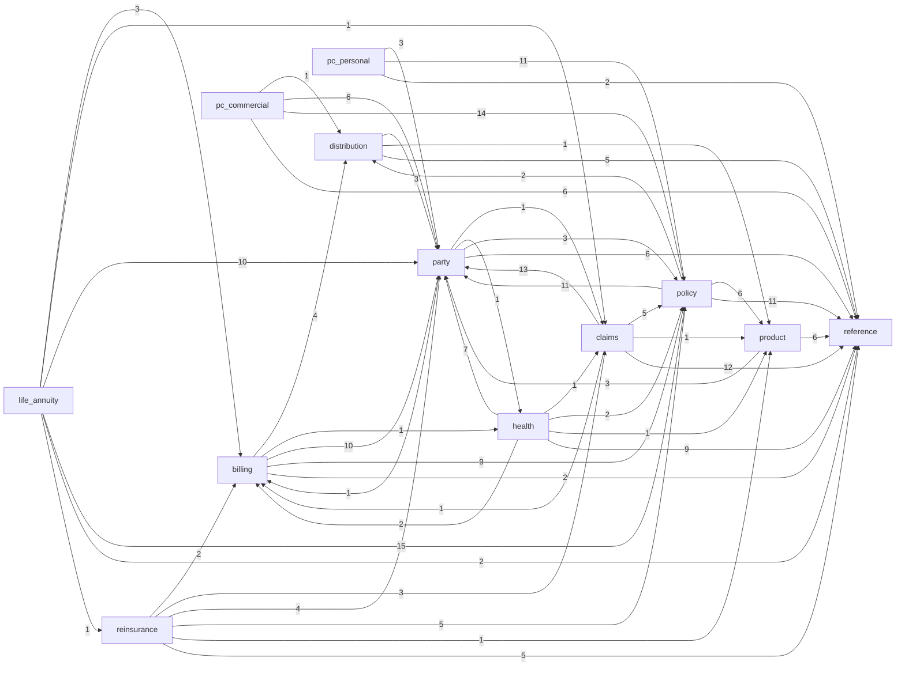

## reference

Relationships within the domain; only key attributes are shown. References to other domains are listed in the [data dictionary](data-dictionary.md).

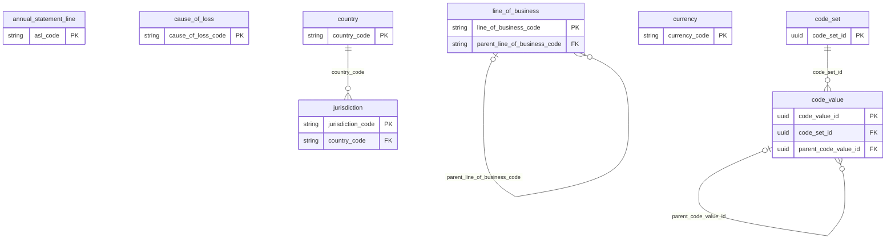

## party

Relationships within the domain; only key attributes are shown. References to other domains are listed in the [data dictionary](data-dictionary.md).

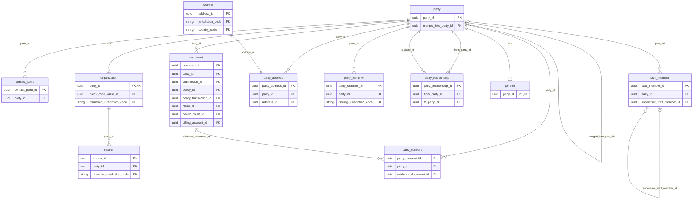

## distribution

Relationships within the domain; only key attributes are shown. References to other domains are listed in the [data dictionary](data-dictionary.md).

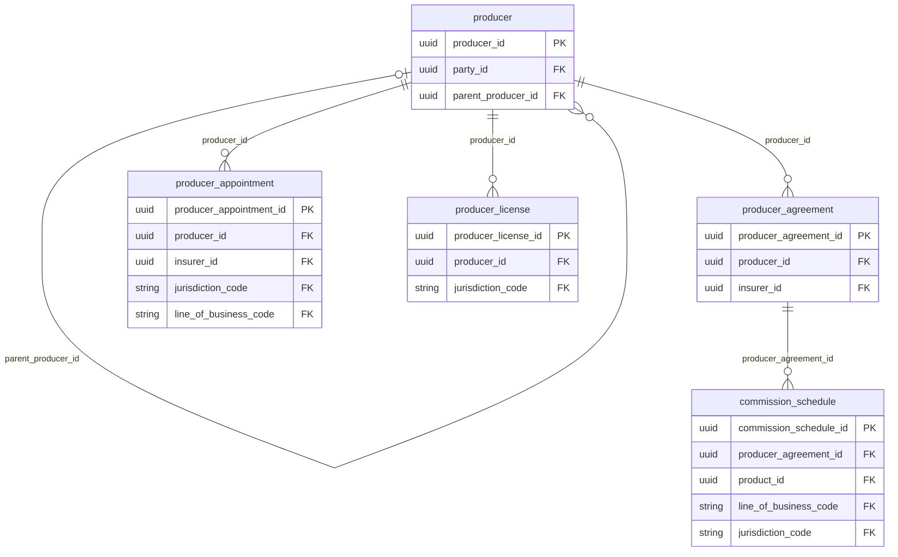

## product

Relationships within the domain; only key attributes are shown. References to other domains are listed in the [data dictionary](data-dictionary.md).

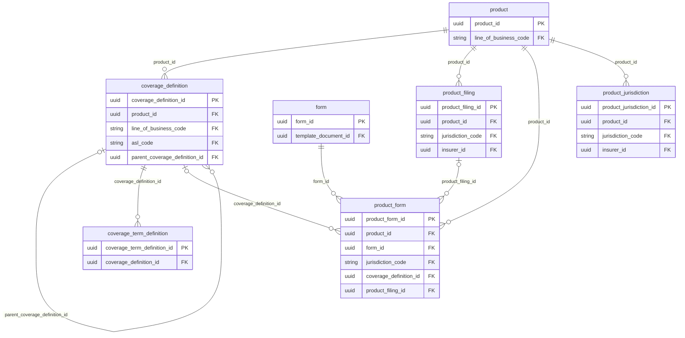

## policy

Relationships within the domain; only key attributes are shown. References to other domains are listed in the [data dictionary](data-dictionary.md).

```mermaid
erDiagram
  insurable_object {
    uuid insurable_object_id PK
    uuid party_id FK
    uuid address_id FK
  }
  policy {
    uuid policy_id PK
    uuid product_id FK
    uuid insurer_id FK
    string line_of_business_code FK
    uuid master_policy_id FK
    string governing_jurisdiction_code FK
    string currency_code FK
    uuid submission_id FK
    uuid replaces_policy_id FK
  }
  policy_coverage {
    uuid policy_coverage_id PK
    uuid policy_id FK
    uuid policy_risk_id FK
    uuid coverage_definition_id FK
    string asl_code FK
  }
  policy_coverage_term {
    uuid policy_coverage_term_id PK
    uuid policy_coverage_id FK
    uuid coverage_term_definition_id FK
  }
  policy_form {
    uuid policy_form_id PK
    uuid policy_id FK
    uuid form_id FK
    uuid policy_coverage_id FK
    uuid policy_risk_id FK
  }
  policy_location {
    uuid policy_location_id PK
    uuid policy_id FK
    uuid address_id FK
  }
  policy_party {
    uuid policy_party_id PK
    uuid policy_id FK
    uuid party_id FK
    uuid policy_risk_id FK
    uuid mailing_address_id FK
  }
  policy_producer {
    uuid policy_producer_id PK
    uuid policy_id FK
    uuid producer_id FK
  }
  policy_rating_modifier {
    uuid policy_rating_modifier_id PK
    uuid policy_id FK
    uuid policy_risk_id FK
    uuid policy_coverage_id FK
    string jurisdiction_code FK
  }
  policy_risk {
    uuid policy_risk_id PK
    uuid policy_id FK
    uuid insurable_object_id FK
    uuid policy_location_id FK
    string rating_jurisdiction_code FK
  }
  policy_term {
    uuid policy_term_id PK
    uuid policy_id FK
    uuid product_filing_id FK
  }
  policy_transaction {
    uuid policy_transaction_id PK
    uuid policy_term_id FK
    uuid reverses_transaction_id FK
    uuid processed_by_staff_member_id FK
  }
  premium_transaction {
    uuid premium_transaction_id PK
    uuid policy_transaction_id FK
    uuid policy_coverage_id FK
    string jurisdiction_code FK
    string asl_code FK
  }
  prior_coverage {
    uuid prior_coverage_id PK
    uuid submission_id FK
    uuid policy_id FK
    uuid carrier_insurer_id FK
    string line_of_business_code FK
  }
  quote {
    uuid quote_id PK
    uuid submission_id FK
    uuid bound_policy_transaction_id FK
  }
  submission {
    uuid submission_id PK
    uuid applicant_party_id FK
    uuid product_id FK
    uuid producer_id FK
    string jurisdiction_code FK
    uuid renewal_of_policy_id FK
    uuid assigned_underwriter_id FK
  }
  underlying_policy {
    uuid underlying_policy_id PK
    uuid policy_id FK
    uuid internal_policy_id FK
    string line_of_business_code FK
  }
  underwriting_decision {
    uuid underwriting_decision_id PK
    uuid submission_id FK
    uuid policy_transaction_id FK
    uuid decided_by_staff_member_id FK
  }
  policy o|--o{ policy : "master_policy_id"
  submission o|--o{ policy : "submission_id"
  policy o|--o{ policy : "replaces_policy_id"
  policy ||--o{ policy_coverage : "policy_id"
  policy_risk o|--o{ policy_coverage : "policy_risk_id"
  policy_coverage ||--o{ policy_coverage_term : "policy_coverage_id"
  policy ||--o{ policy_form : "policy_id"
  policy_coverage o|--o{ policy_form : "policy_coverage_id"
  policy_risk o|--o{ policy_form : "policy_risk_id"
  policy ||--o{ policy_location : "policy_id"
  policy ||--o{ policy_party : "policy_id"
  policy_risk o|--o{ policy_party : "policy_risk_id"
  policy ||--o{ policy_producer : "policy_id"
  policy ||--o{ policy_rating_modifier : "policy_id"
  policy_risk o|--o{ policy_rating_modifier : "policy_risk_id"
  policy_coverage o|--o{ policy_rating_modifier : "policy_coverage_id"
  policy ||--o{ policy_risk : "policy_id"
  insurable_object ||--o{ policy_risk : "insurable_object_id"
  policy_location o|--o{ policy_risk : "policy_location_id"
  policy ||--o{ policy_term : "policy_id"
  policy_term ||--o{ policy_transaction : "policy_term_id"
  policy_transaction o|--o{ policy_transaction : "reverses_transaction_id"
  policy_transaction ||--o{ premium_transaction : "policy_transaction_id"
  policy_coverage o|--o{ premium_transaction : "policy_coverage_id"
  submission o|--o{ prior_coverage : "submission_id"
  policy o|--o{ prior_coverage : "policy_id"
  submission ||--o{ quote : "submission_id"
  policy_transaction o|--o{ quote : "bound_policy_transaction_id"
  policy o|--o{ submission : "renewal_of_policy_id"
  policy ||--o{ underlying_policy : "policy_id"
  policy o|--o{ underlying_policy : "internal_policy_id"
  submission o|--o{ underwriting_decision : "submission_id"
  policy_transaction o|--o{ underwriting_decision : "policy_transaction_id"
```

## pc_personal

Relationships within the domain; only key attributes are shown. References to other domains are listed in the [data dictionary](data-dictionary.md).

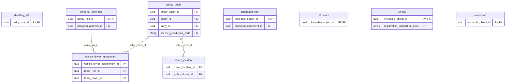

## pc_commercial

Relationships within the domain; only key attributes are shown. References to other domains are listed in the [data dictionary](data-dictionary.md).

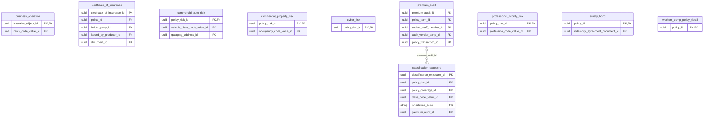

## life_annuity

Relationships within the domain; only key attributes are shown. References to other domains are listed in the [data dictionary](data-dictionary.md).

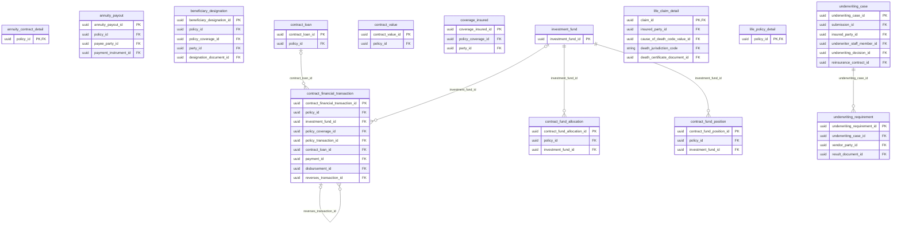

## health

Relationships within the domain; only key attributes are shown. References to other domains are listed in the [data dictionary](data-dictionary.md).

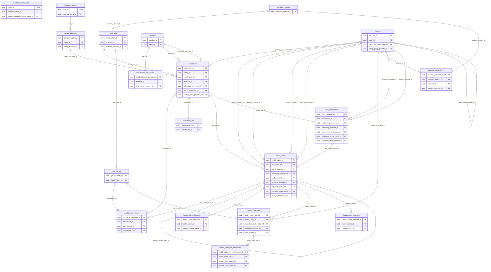

## claims

Relationships within the domain; only key attributes are shown. References to other domains are listed in the [data dictionary](data-dictionary.md).

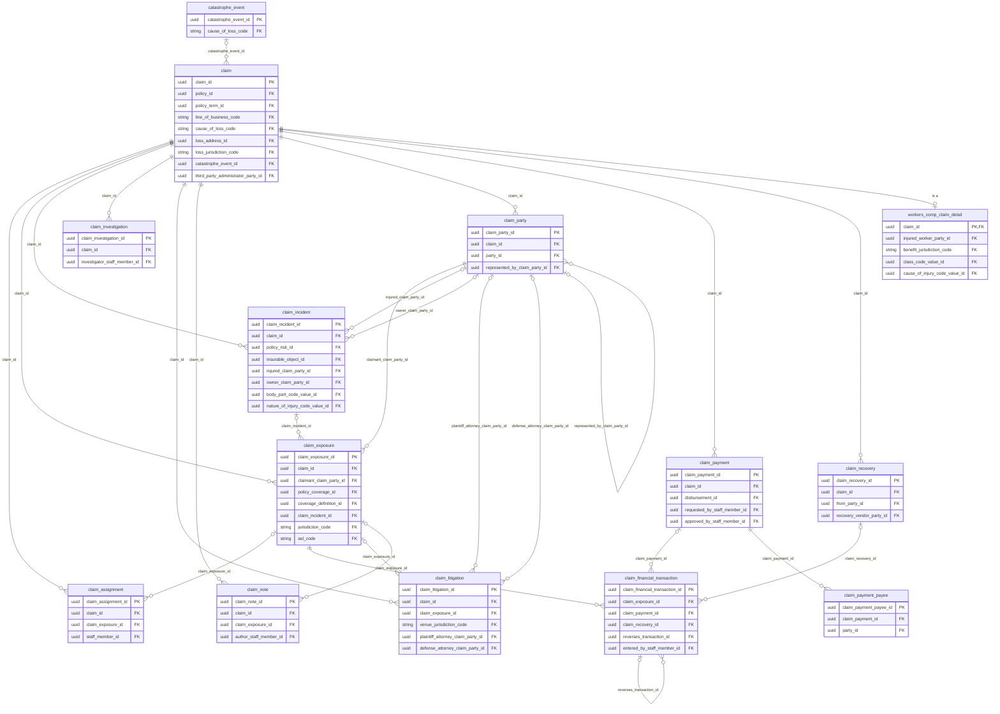

## billing

Relationships within the domain; only key attributes are shown. References to other domains are listed in the [data dictionary](data-dictionary.md).

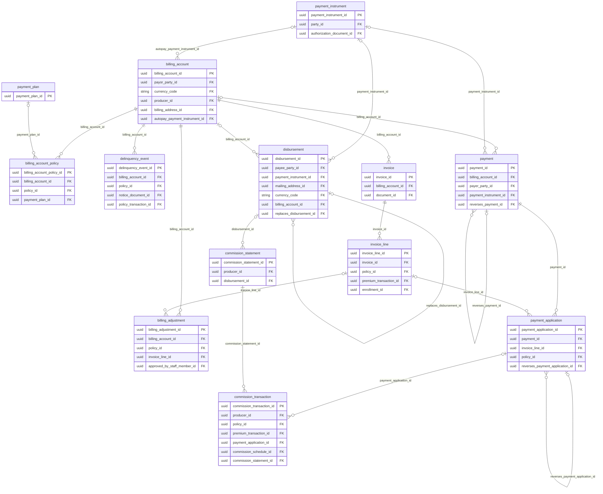

## reinsurance

Relationships within the domain; only key attributes are shown. References to other domains are listed in the [data dictionary](data-dictionary.md).

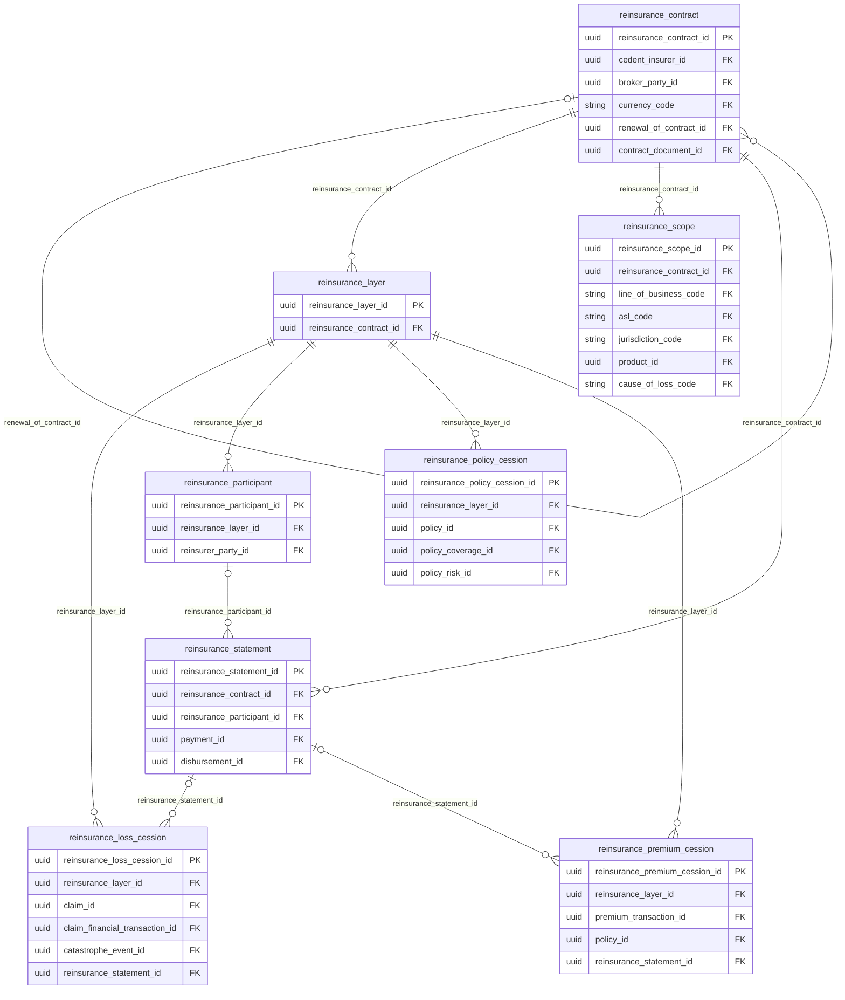
